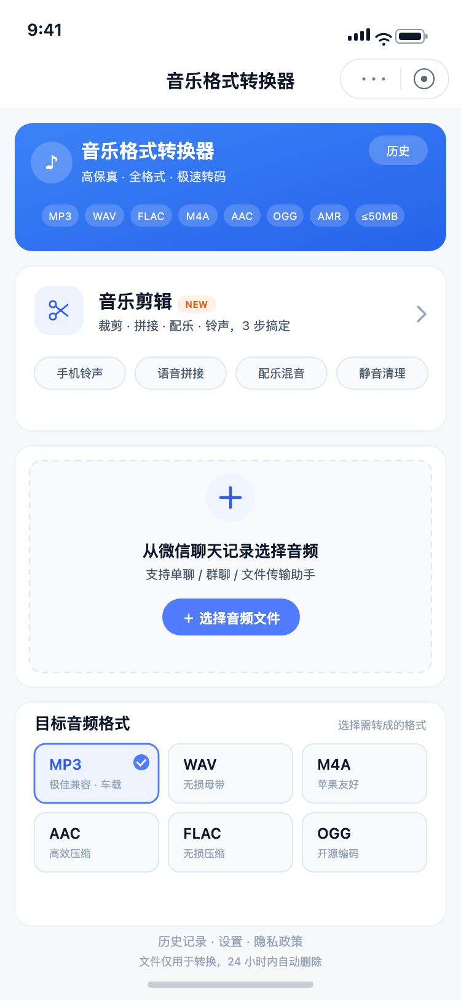
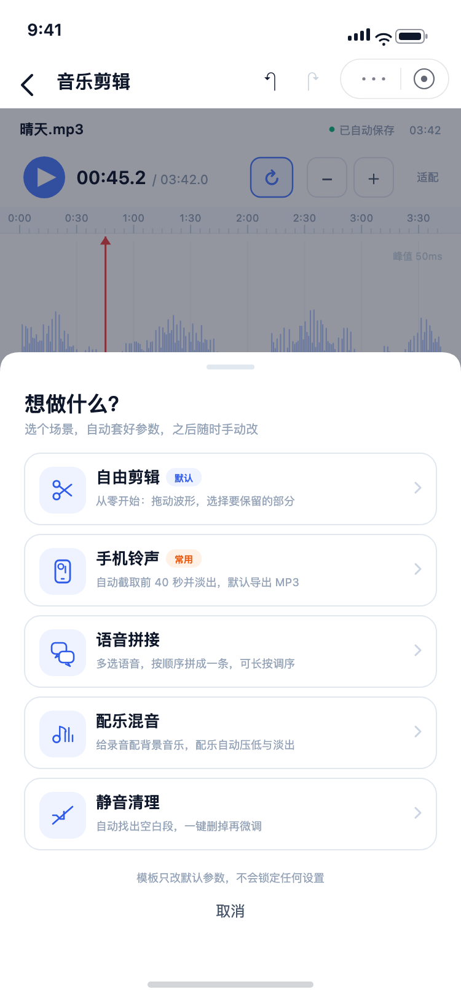
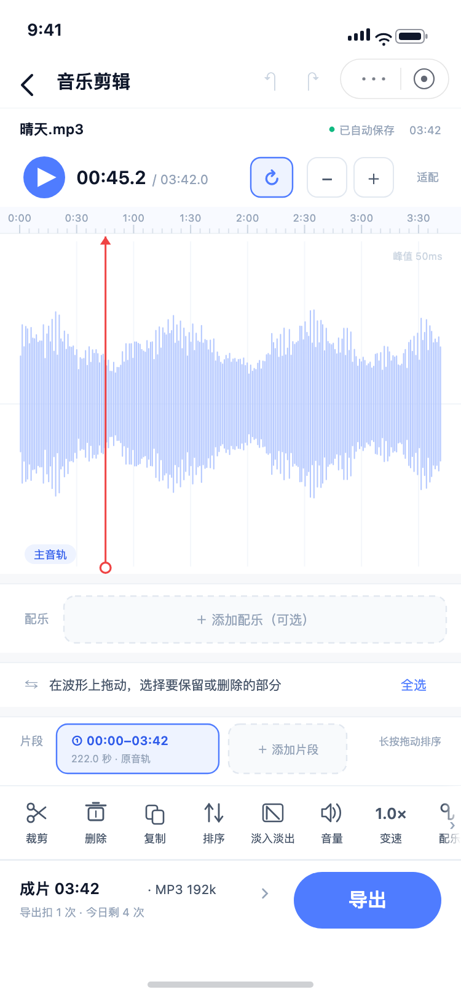
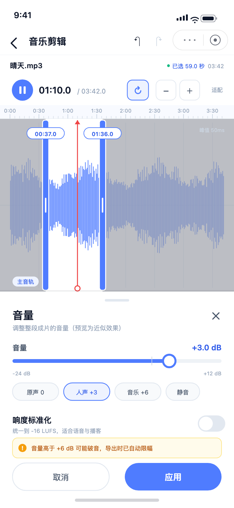
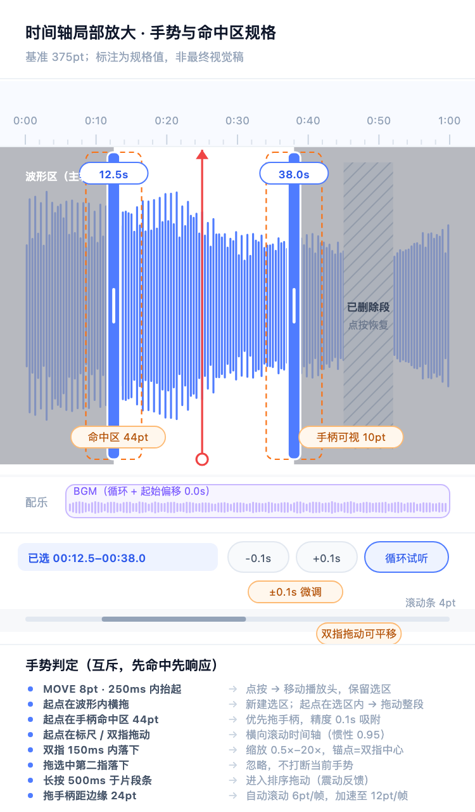
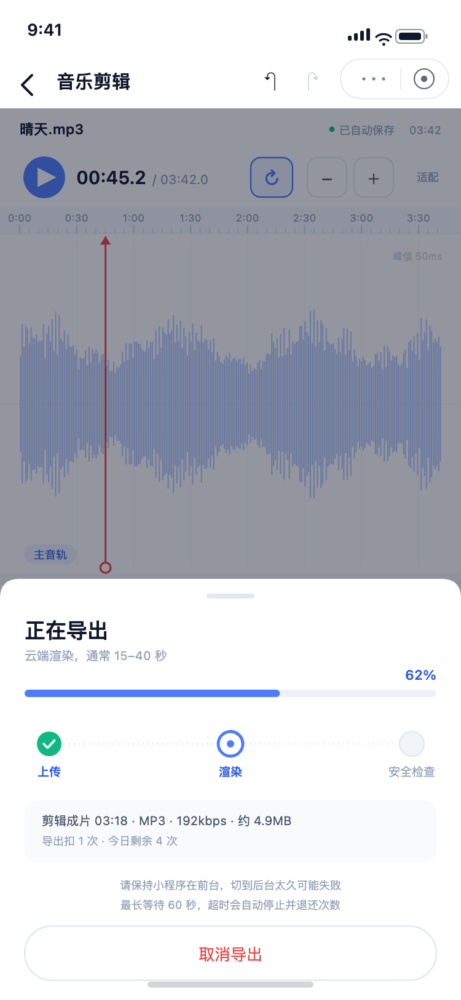
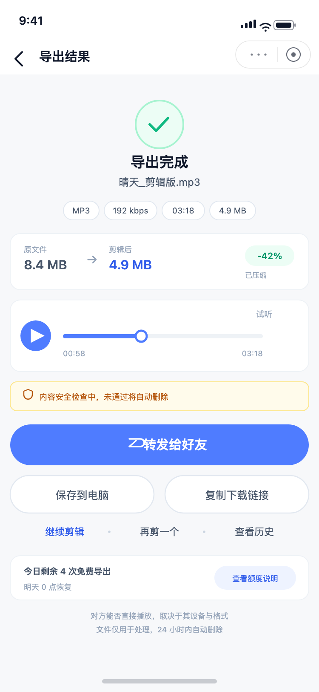
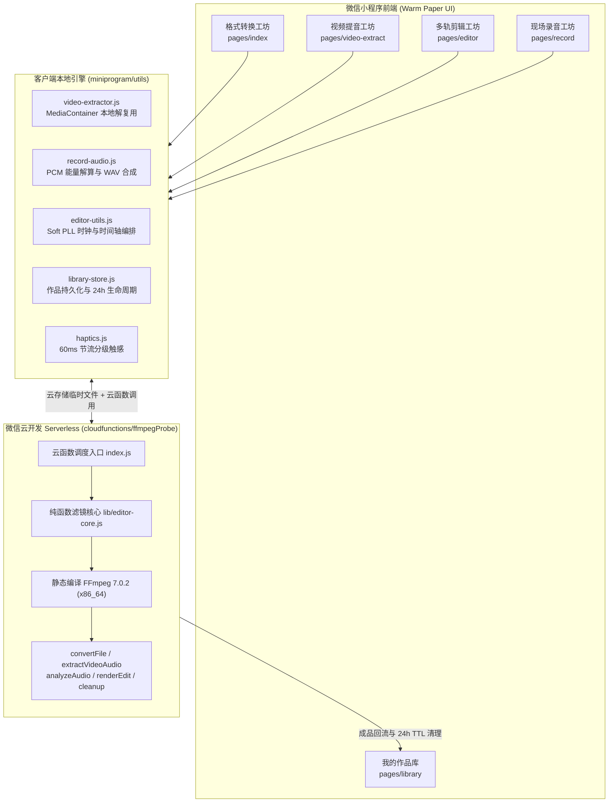
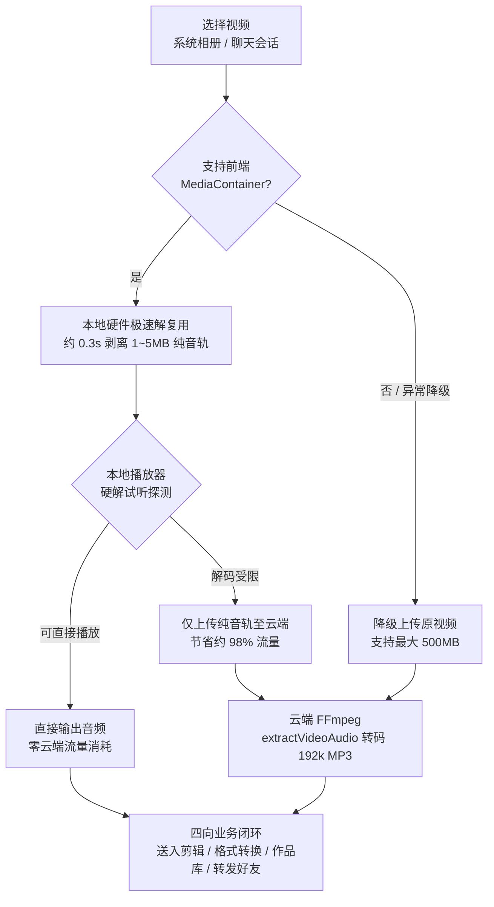
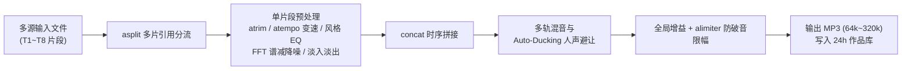

# WeChat Audio Toolkit (微信音频全能工具箱)

基于微信小程序原生框架与云开发 Serverless FFmpeg 7.0.2 引擎的专业级音频工作台。集成了**音频格式转换与极限压缩**、**视频提取音频（双核混合架构）**、**专业多轨非线性音乐剪辑**、**现场高清录音**与**作品库管理**五大核心工坊。

---

## 界面设计原型预览 (Design Prototypes)

> 说明：以下展示的图片均由仓库内 [docs/research/ux/](docs/research/ux/) 目录下的矢量设计原型（`mockup-01` ~ `mockup-07`）渲染生成的高清静态预览图（**设计原型**），用于直观呈现核心交互路径、多轨波形选区与导出反馈状态。

### 1. 入口工作台与场景模板

| 首页入口与格式转换（设计原型） | 场景化剪辑模板面板（设计原型） |
| :---: | :---: |
|  |  |
| 首页聚合格式转换主卡、音乐剪辑入口与 4 个快捷场景入口 | 支持自由剪辑、手机铃声、语音拼接、配乐混音、静音清理 5 大模板 |

### 2. 多轨剪辑器交互与时间轴规格

| 编辑器默认态与波形（设计原型） | 选区手柄与音量调音台（设计原型） | 时间轴局部放大与手势规格（设计原型） |
| :---: | :---: | :---: |
|  |  |  |
| 50ms 真实峰值波形、播放指针、配乐轨与底部导出栏 | 44pt 手柄命中区、响度标准化 (-16 LUFS) 与防破音提示 | 互斥手势判定、0.1s 精度微调与双指缩放锚点规范 |

### 3. 云端渲染导出与结果闭环

| 云端渲染三步进度弹层（设计原型） | 导出结果与多端分享（设计原型） |
| :---: | :---: |
|  |  |
| 上传 → 云端渲染 → 安全检查三步进度与 60s 超时保护 | 体积对比瘦身看板、原声试听与微信好友/PC 端多向流转 |

---

## 系统架构与核心工作流

### 整体混合架构图 (Client + Serverless FFmpeg)



### 视频提取音频：双核混合加速流程



### 多轨非线性剪辑：FFmpeg 滤镜图渲染管线



---

## 五大核心工坊功能拆解

### 1. 音频格式转换与极限压缩工坊 (`pages/index`)
- **全格式双向转换**：深度支持 `MP3`、`WAV`、`AAC`、`M4A`、`FLAC`、`OGG` 等多格式双向互转与重编码。
- **6 档智能压缩控制台**：提供 `64k` (极小体积 · 微信畅发)、`96k` (精简省流)、`128k` (网络均衡)、`192k` (标准高保真 · 官方推荐)、`256k` (超清音质)、`320k` (极品母带) 码率矩阵。
- **动态体积预估看板**：前端毫秒级测算压缩前后体积对比与瘦身百分比（最高可瘦身 85% 以上）。
- **高保真原声试听播放器**：支持滑动条平滑拖拽寻位、指尖跟随浮动时码气泡与物理静音拨片硬件穿透（`obeyMuteSwitch: false`）。

### 2. 视频提取音频工坊 (`pages/video-extract`)
- **首创双核混合架构 (Client-First Hybrid Architecture)**：
  - 前端优先调用 `wx.createMediaContainer` 在本地毫秒级剥离解复用纯音轨（约 0.3 秒，仅 1MB~5MB）；
  - 仅将轻量纯音频流上传至云端 FFmpeg 转码为标准 `192k MP3`，节省 98% 移动网络流量，避免大视频直传导致的 60 秒网络超时（`uploadFile:fail timeout`）；
  - 遇到非标准封装或手机硬件解码器不支持时，自动降级上传原视频至云端提取。
- **iOS 系统相册自适应双阶兼容选取**：首选原画选取，若因系统沙盒、杜比视界 HDR、4K HEVC 或 iCloud 优化存储受限，自动静默切换兼容流重试，并支持降级至 `wx.chooseVideo` 与微信聊天/文件传输助手直选原文件。
- **四向全业务闭环**：提取结果一键直送多轨剪辑工坊、格式转换压缩、沉淀至我的作品库或转发给微信好友。

### 3. 专业多轨非线性音乐剪辑工坊 (`pages/editor`)
- **纯净通用 8 轨并行混音架构**：支持动态扩展至 8 条独立音轨（`T1~T8`），各轨支持独立音量增益、静音与智能人声避让（Auto-Ducking 遇人声自动下压伴奏 `-12dB`）。
- **全幅自适应真实声波切片**：基于 50ms 真实物理振幅切片（`uint8 peak/rms`），在 `0.5x` 全览至 `4.0x` 精细缩放倍率下波形均连贯充满音轨卡片。
- **高精物理插值时钟引擎 (Soft PLL)**：35ms 高频刷新与严格单调性保证，消除播放时间码跳跃与台阶式抖动，跨片段过渡平滑穿透。
- **专业非线编交互工具箱**：
  - 选择模式 (`V`) 与激光瞄准剃刀切割 (`C`)：所点即所剪，附带切断闪光与分级机械震动；
  - 智能双向磁吸贴合：拖拽靠近 `0s` 起点或播放指针自动吸附；
  - 同轨重叠碰撞自愈：切开或拖动产生重叠时，后段音频自动下移至下一音轨；
  - 跨轨复制粘贴：深拷贝片段至剪贴板并按播放指针精确粘贴。
- **独立调音中枢**：
  - 6 档动态热变速 (`0.5x~2.0x`)：`atempo` 变频保持原音调，播放中热重置物理时钟锚点；
  - 8 种风格硬件级 EQ 均衡器：原声无染、清晰人声、复古电台、澎湃低音、明亮空气、温暖黑胶、影院环绕、消除人声；
  - 多阶频域 FFT 谱减智能降噪：`3dB` / `6dB` / `12dB` 阶梯降噪，滤除环境底噪与高频电流啸叫；
  - 片段独立增益 (`-24dB~+12dB`) 与全局 `alimiter` 防破音限幅保护。

### 4. 现场高清录音工坊 (`pages/record`)
- **原生 PCM 实时流与物理能量算法**：毫秒级均方根振幅 (`RMS`) 与真峰值能量解算，驱动 28 柱动态滚动声波谱线与环境分贝指示胶囊（安静/清晰/充沛/过载）。
- **随时中断即刻试听回放**：暂停或遭遇系统来电/微信语音打断时，自动切片合成标准 44 字节 `RIFF/WAVE`，内置即时试听播放器并支持平滑继续追加录音。
- **标准无损导出**：录音完成直接输出标准无损 `WAV` 原声，一键直送格式转换或多轨剪辑。

### 5. 我的作品库 (`pages/library`)
- **跨业务统一沉淀**：格式转换、视频提取、音乐剪辑与现场录音成品自动持久化入库。
- **安全与生命周期管理**：配备 24 小时自动物理到期倒计时，支持相同 `fileID` 去重置顶、按业务分类/格式标签一键筛选、一键清空与微信好友二次转发分享。

---

## 核心技术栈与目录结构

### 技术栈选型

| 维度 | 技术方案 | 说明 |
| :--- | :--- | :--- |
| 前端框架 | 微信小程序原生框架 (`WXML` / `WXSS` / `JavaScript`) | 纯净极简 Warm Paper 暖纸美学设计体系 |
| 服务端 | 微信云开发 Serverless (`Node.js 16.13`) | 云函数、云存储与云数据库一体化架构 |
| 音频引擎 | Linux x86_64 静态编译 FFmpeg 7.0.2 | 封装于 `cloudfunctions/ffmpegProbe`，支持全编码转码 |
| 触感系统 | 自研全局分级微交互震动引擎 (`utils/haptics.js`) | 包含 60ms 节流门禁与静默容错保护 |
| 数据持久化 | 客户端本地持久化与云数据库双重保障 | `library-store.js` 管理作品沉淀与 24h 自动生命周期 |

### 项目目录结构

```text
wechat-audio-toolkit/
├── cloudfunctions/                     # 微信云开发云函数
│   ├── ffmpegProbe/                    # 核心音频处理云函数 (FFmpeg 7.0.2 引擎)
│   │   ├── index.js                    # 云函数调度分发入口
│   │   ├── lib/
│   │   │   └── editor-core.js          # 音频剪辑滤镜图解算与纯函数核心库
│   │   └── package.json
│   └── audioConvert/                   # 格式转换辅助云函数
├── miniprogram/                        # 小程序前端工程
│   ├── pages/
│   │   ├── index/                      # 格式转换与极限压缩主工作台
│   │   ├── editor/                     # 专业多轨音乐剪辑工坊
│   │   ├── video-extract/              # 视频提取音频专属工坊
│   │   ├── record/                     # 现场高清录音工坊
│   │   ├── library/                    # 我的作品库
│   │   └── settings/                   # 设置与关于页面
│   ├── utils/
│   │   ├── editor-utils.js             # 剪辑时间轴与算法工具库
│   │   ├── video-extractor.js          # 视频提取双核解复用客户端引擎
│   │   ├── record-audio.js             # 录音 PCM 能量分析与 WAV 封装引擎
│   │   ├── library-store.js            # 作品库数据管理与生命周期调度
│   │   ├── haptics.js                  # 全局分级触感反馈防抖引擎
│   │   └── mono-icons.js               # 单色矢量图标库
│   ├── app.js                          # 全局生命周期与云环境初始化
│   ├── app.json                        # 页面路由与窗口配置
│   └── app.wxss                        # 全局样式与暖纸设计规范
├── scripts/                            # 自动化测试与验证套件
│   ├── editor-spike/
│   │   ├── test_pure.js                # 纯函数与核心算法单测
│   │   └── frontend-test.js            # 前端剪辑工坊端到端交互测试
│   └── page-smoke/
│       ├── video-extract-test.js       # 视频提取双核解复用状态机测试
│       └── record-library-test.js      # 录音与作品库单测
├── docs/                               # 开发文档、设计原型与预览图
│   ├── images/                         # 从设计原型渲染的高清 PNG 预览图
│   ├── research/ux/                    # 7 套 UX 矢量设计原型 (*.svg)
│   ├── DEV_LOG.md                      # 详细开发记录与版本演进日志
│   ├── PRD.md                          # 产品需求文档
│   ├── TASK_PLAN.md                    # 架构与规划文档
│   └── FEASIBILITY.md                  # 可行性与技术限制分析报告
├── project.config.json                 # 微信开发者工具项目配置
└── README.md                           # 项目说明文档
```

---

## 快速开始与部署指南

### 1. 前置准备
- 安装最新版 [微信开发者工具](https://developers.weixin.qq.com/miniprogram/dev/devtools/download.html)。
- 开通微信小程序账号并获取 AppID（支持个人主体）。
- 在微信小程序控制台中开通「微信云开发」服务，记录环境 ID（例如：`cloud1-xxx`）。

### 2. 导入工程与配置
1. 打开微信开发者工具，点击「导入项目」，选择本项目根目录。
2. 在 `project.config.json` 中配置您的 `appid`。
3. 打开 `miniprogram/envList.js` 与 `miniprogram/app.js`，将云开发环境 ID 替换为您自己的环境 ID。

### 3. 部署云函数
1. 在微信开发者工具左侧目录树中，找到 `cloudfunctions/ffmpegProbe` 目录。
2. 鼠标右键点击该目录，选择「上传并部署：云端安装依赖（不上传 node_modules）」。
3. 等待云端编译打包完成，在云开发控制台中将该云函数的超时时间调整为 `60s`，内存配置建议设置为 `512MB` 或 `1024MB`。

### 4. 运行全量自动化测试
本项目提供涵盖纯函数、算法解算、前端组件交互与端到端状态机的完整测试体系（无需依赖外部网络）：

```bash
# 1. 运行纯函数与核心音频算法单测
node scripts/editor-spike/test_pure.js

# 2. 运行剪辑工坊前端交互与状态机测试
node scripts/editor-spike/frontend-test.js

# 3. 运行视频提取双核解复用与自适应重试测试
node scripts/page-smoke/video-extract-test.js

# 4. 运行现场录音与作品库单测
node scripts/page-smoke/record-library-test.js
```

---

## 核心设计规范与合规说明

1. **Warm Paper 暖纸美学**：全局采用米纸底衬（`#F8F6F2`）、纯白卡片（`#FFFFFF`）、深炭黑字体（`#1C1917`）与暖记号橙（`#FF6B00`）高光，排版舒展克制，杜绝高饱和度色彩污染。
2. **移动端触控工程学**：关键操作按钮均具备清晰的触控热区、双列对称排版防溢出保护，并深度整合了分级触觉震动马达反馈。
3. **用户隐私与数据生命周期**：严格遵守个人信息保护要求，所有音视频临时缓存产物均由服务端设置 24 小时自动物理清理机制，杜绝数据堆积。

---

## 开源协议

本项目采用 MIT 许可证。商业使用或二次分发请遵循开源协议规范。
