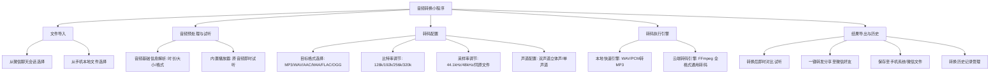

# 音乐音频格式转换小程序 - 产品需求文档 (PRD)

## 1. 文档信息

| 项目名称 | 音乐音频格式转换微信小程序 (AudioConvert Pro) |
| :--- | :--- |
| 文档版本 | v1.0.0 |
| 编写时间 | 2026-10-27 |
| 目标平台 | 微信小程序 (iOS / Android / 微信开发者工具) |
| 技术栈 | 微信小程序原生框架 (WXML/WXSS/JS) + 微信云开发 (Cloud Functions + Cloud Storage) + FFmpeg 转码引擎 + 本地轻量处理 |

---

## 2. 产品背景与目标

### 2.1 用户痛点
1. **微信生态内文件格式受限**：微信聊天中经常接收到各种音频文件（如 `.m4a` 录音、`.flac` 无损音乐、`.ogg`、`.amr` 语音、`.wav` 伴奏等），但在车载播放器、特定播放器或上传至某些平台时，往往仅支持标准 `.mp3` 格式。
2. **跨平台设备兼容性问题**：iOS 录音多为 `.m4a`/`.aac`，Windows/老旧设备多支持 `.mp3`/`.wav`，用户急需快速互转。
3. **现有工具门槛高**：PC 端剪辑软件（如 Audacity、格式工厂）需要开电脑操作；网页版转换工具广告多、上传速度慢、存在隐私泄露风险；App 需额外下载安装，使用频率低但场景紧急。

### 2.2 产品定位
**轻量、高效、开箱即用的微信原生音频格式转换与音频处理工具。**
无需下载 App，在微信聊天记录中直接选择音频文件，一键转码为目标格式，支持在线试听、保存至本地以及直接分享回微信好友。

### 2.3 核心指标 (KPI)
- 转换成功率 > 98.5%
- 单音频转换耗时（< 15MB）：云端 3~8 秒内完成，轻量本地转码 < 3 秒
- 用户完成一次转换的核心操作路径 ≤ 3 步（选择文件 -> 选格式 -> 转换导出）

---

## 3. 用户群体与典型场景

| 角色 | 典型使用场景 | 核心诉求 |
| :--- | :--- | :--- |
| **普通微信用户** | 微信收到的语音/手机录音（.m4a/.amr）需要转为 MP3 发送给其他人或上传到办公系统 | 操作傻瓜化、一键分享微信好友 |
| **音乐爱好者 / 创作者** | 收到 FLAC/APE/WAV 格式的高清伴奏或 DEMO，需压缩为 320k MP3 进行快速试听分享 | 支持高音质（320kbps）、无损保留、采样率可调 |
| **办公 / 学生群体** | 会议录音、讲座音频剪辑并转码为通用格式存储 | 文件体积适中、转码速度快、支持试听验证 |

---

## 4. 功能架构与矩阵



### 4.1 格式支持矩阵

| 输入格式 | 支持转换的目标格式 | 处理模式 | 典型用途 |
| :--- | :--- | :--- | :--- |
| **MP3** | WAV, AAC, M4A, FLAC, OGG | 云端引擎 | 压缩、高兼容性转换 |
| **M4A / AAC** | MP3, WAV, FLAC, OGG | 云端引擎 | 苹果设备录音转 MP3 |
| **WAV** | MP3, AAC, M4A, FLAC, OGG | 本地快速 / 云端引擎 | 无损无压缩转通用有损 |
| **FLAC** | MP3, WAV, AAC, M4A, OGG | 云端引擎 | HiFi 无损音乐转码 |
| **OGG** | MP3, WAV, AAC, M4A, FLAC | 云端引擎 | 游戏/网游/网络音频通用化 |
| **AMR** | MP3, WAV | 云端引擎 | 早期手机通话/微信早期语音转码 |
| **WMA** | MP3, WAV, AAC, M4A | 云端引擎 | Windows Media 老音频转换 |

---

## 5. 详细功能规格说明

### 5.1 模块一：音频文件导入
- **入口触发**：首页醒目「选择音频文件」按钮，支持拖拽区域视觉反馈。
- **调用 API**：`wx.chooseMessageFile`，参数限制 `type: 'file'`，扩展名白名单包含 `['mp3', 'wav', 'aac', 'm4a', 'flac', 'ogg', 'wma', 'amr']`。
- **文件校验**：
  - 单文件体积限制：≤ 50MB（保障小程序内存与云函数网络传输顺畅）。
  - 非法格式提示友好弹窗引导。
- **解析信息展示**：
  - 文件名（支持超长省略与全名展示）。
  - 文件体积（自动换算为 KB/MB）。
  - 源格式识别标签（徽章 Badge 样式）。

### 5.2 模块二：源音频预览与播放
- **播放控制器**：
  - 采用 `wx.createInnerAudioContext()`。
  - 具备「播放/暂停」、「时间轴拖动」、「当前时间 / 总时长」展示。
  - 对于系统内核不支持原生播放的特殊格式（如 FLAC/OGG），提示“该格式暂不支持直接试听，可转为 MP3 后试听”。

### 5.3 模块三：转换参数配置
- **目标格式选择**：
  - 栅格单选卡片：`MP3`（默认推荐）、`WAV`、`AAC`、`M4A`、`FLAC`、`OGG`。
  - 标签说明（如 MP3 标注“通用兼容”，WAV 标注“无损无压缩”，FLAC 标注“无损压缩”）。
- **音频质量配置**（高级选项折叠展开）：
  - **比特率 (Bitrate)**：
    - 320 kbps (超清高品质 - 推荐音乐)
    - 192 kbps (标准高质 - 兼顾体积与音质)
    - 128 kbps (紧凑体积 - 适合人声/播客)
  - **采样率 (Sample Rate)**：
    - 保持原音频 / 44.1 kHz (CD级) / 48 kHz (影视级)
  - **声道数 (Channels)**：
    - 立体声 (Stereo / 2声道) / 单声道 (Mono / 1声道)

### 5.4 模块四：转码执行引擎
- **执行流程状态机**：
  `IDLE (待开始)` -> `UPLOADING (正在上传原文件)` -> `TRANSCODING (云端转码中)` -> `SUCCESS (转码完成)` / `FAILED (转码失败)`
- **转码引擎策略**：
  - **云端转码（默认主引擎）**：
    - 前端通过 `wx.cloud.uploadFile` 上传至临时云存储目录 `temp_audios/`。
    - 触发云函数 `audioConvert`，传入 `fileID`、`targetFormat`、转码参数。
    - 云函数内部基于 FFmpeg 执行转码命令：
      `ffmpeg -i input.[ext] -b:a 192k -ar 44100 -ac 2 output.[targetExt]`
    - 转码成功后生成结果文件上传云存储，返回结果 `fileID`、下载 URL、转换后体积、耗时。
    - 自动清理云端临时输入文件，降低存储占用。
- **异常容错机制**：
  - 超时重试（最长保护时间 45s）。
  - 损坏文件智能识别并提示明确错误文案。

### 5.5 模块五：结果呈现与导出
- **转码结果卡片**：
  - 体积前后对比（如：`12.4 MB -> 3.2 MB`，节省 74%）。
  - 转码耗时与参数摘要。
- **操作能力**：
  - **在线试听**：即时播放转换后的音频，确认音质与完整性。
  - **微信好友分享**：调用 `wx.shareFileMessage`，直接发送给当前微信联系人或微信群。
  - **保存到手机**：下载并调用 `wx.saveFile` / `wx.openDocument`。
  - **复制下载链接**：生成短时有效链接，方便电脑端浏览器下载。

### 5.6 模块六：转换历史与记录
- **本地持久化存储**：使用 `wx.setStorage` 记录最近 20 条转换成功记录。
- **数据项**：原文件名、原格式、目标格式、原大小、转换后大小、转换时间戳、临时文件/云存储引用。
- **管理功能**：
  - 点击历史记录可重播、重新下载与分享。
  - 一键清空历史记录。

---

## 6. 非功能性需求与技术指标

1. **兼容性**：
   - 微信基础库 ≥ 2.20.0。
   - 覆盖 iOS 12+、Android 8+、鸿蒙 HarmonyOS 2+ 及 PC 微信小程序端。
2. **性能体验**：
   - 首屏渲染冷启动时间 < 800ms。
   - 交互响应时间 < 100ms。
   - 上传与转码过程中提供明确的百分比或步骤条动效，消除用户焦虑。
3. **安全性与隐私保护**：
   - 音频数据仅作为用户自主转码使用，禁止第三方爬取或非授权持久存储。
   - 云存储临时音频文件设置 24 小时自动生命周期过期（TTL）自动物理销毁。
4. **包体积控制**：
   - 小程序主包体积控制在 1.5MB 以内。
   - 静态图标采用 SVG / 矢量 Iconfont，避免高分辨率无用位图占用体积。

---

## 7. 页面交互流程设计

```
[首页 (Index)]
   ├── 顶部功能标题与格式支持跑马灯/标签
   ├── 核心区域：音频选择与拖拽卡片
   ├── 音频信息卡片（选定后出现）
   │    ├── 文件名称、大小、原格式徽章
   │    └── 音频播放控制条（播放/暂停/进度）
   ├── 转码设置卡片
   │    ├── 目标格式网格（MP3 / WAV / M4A / AAC / FLAC / OGG）
   │    └── 高级选项（比特率/采样率/声道）
   ├── 操作按钮：“立即转换”
   └── 转码进度弹窗/卡片（步骤条 + 加载动画）

[结果与导出面板]
   ├── 成功状态标志 + 体积压缩对比
   ├── 新音频试听控制条
   ├── 操作快捷条：[发给微信好友] [保存到手机] [复制下载链接]
   └── “继续转换下一首”

[历史记录浮层 / 页面]
   ├── 历史转换流水列表
   ├── 快捷操作：直接播放、重新导出、单条删除
   └── 底部“清空历史”
```
