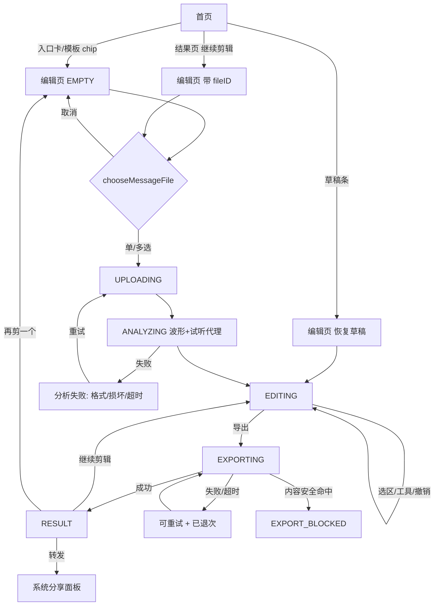

# 音乐剪辑 · UX 交互规格与低保真线框


| 项 | 内容 |
| :--- | :--- |
| 文档版本 | v1.0（2026-10-28）／作者 ux-designer |
| 状态 | 可进入开发评审；【待产品确认】13 项见 §15。客户端能力口径以 `CLIENT_CAPABILITIES.md` 为准（peaks、预览、手势、接口字段），本文只做 UX 细化。 |
| 关联 | [PRD](../PRD.md) · [TASK_PLAN §6](../TASK_PLAN.md) · [首页实现](../../miniprogram/pages/index/index.js) · 线框图 [docs/research/ux/](./ux/) |
| 依赖 | 波形/预览能力见 `docs/research/CLIENT_CAPABILITIES.md`（task-1）；FFmpeg 命令与限额见 `docs/research/FFMPEG_EDIT_SPIKE.md`（task-2）。冲突时以后者实测为准并回写本文。 |

> **【对齐说明 · 2026-10-28 Lead 回写】本规格是 v1.1 的交互细化材料；凡与 [MUSIC_EDITOR_DESIGN v0.2](../MUSIC_EDITOR_DESIGN.md) §5.6「冻结行为表」冲突者，一律以主文档为准。已知冲突及冻结值：① 主轨源 **P0 ≤3（SPIKE 后 ≤5），不采纳 9**；② 导出格式 **P0 mp3/wav/flac，m4a P1，OGG 不支持**；③ 草稿 **24h（不是 7 天）**；④ 铃声 **>40s 硬拦**；⑤ 额度 **测试期不限次数（开关控制），UI 不做 5 次/日死文案**；⑥ 选区最小 **0.2s**；⑦ **不提供取消导出**，导出中可退后台查询；⑧ 页面现实：当前只有 `pages/index` + `pages/settings`，没有独立 task/result/history 页，入口按「首页结果卡/历史弹窗」实现；⑨ 埋点/指标统一以主文档 §7.5 与 §2.4 为准（`editor_enter` 等）。线框（`ux/*.svg`）保留作视觉参考，涉及上述值以本说明为准。

**一句话**：把微信里的音频变成能听的成片——选一段、拖一下、导出转发，3 次主要点击以内；编辑页单页完成；无曲库、无公开分享、不在端内编码。

## 1. 产品边界与设计原则

### 1.1 硬边界（设计不得越界）

| # | 边界 | UX 含义 |
| :--- | :--- | :--- |
| B1 | 个人主体 / 免费 / 类目「工具 > 图片处理」 | 无会员、无广告、无曲库、无在线听歌、无社区、无公开链接 |
| B2 | 只能从微信会话文件导入或录音 | 不出现"手机本地文件/音乐 App"入口，不伪造文件浏览器 |
| B3 | 端内不做编码，导出由云端 FFmpeg 渲染（60s 超时） | 打开/波形/预览免费即时；导出异步，必须有进度与超时兜底 |
| B4 | 编辑源 ≤10min、≤50MB；输出 mp3/m4a/wav（flac/ogg 高级） | 超限双重拦截；成片时长同样 ≤10min |
| B5 | 每日 5 次免费额度，与转换共享；仅导出扣 1 次 | 导入/分析/波形/预览/撤销免费；导出栏常显剩余次数 |
| B6 | 预览 = 顺序播放 + 音量渐变近似 + 双实例 BGM，不做端内渲染 | 必须有一次性诚实提示；不承诺所见即所得 |
| B7 | 内容安全异步检测，命中 risky 删除产物 | 结果页可显示"检测中"；命中后拦截且不暴露细节 |
| B8 | 无"保存到手机"能力 | 结果页只有：转发给好友 / 保存到电脑 / 复制链接 |

### 1.2 设计原则

1. **一段就够**：进编辑器即自由剪辑，不先选模板、不看引导页。
2. **手势优先、按钮兜底**：拖波形 = 选区；精确操作都有 ±0.1s 按钮，不依赖双指。
3. **预览诚实**：只在一处说明"预览近似、导出为准"，不在每个面板重复。
4. **随时可退**：30 步撤销；退出自动存草稿；导出可取消且退次。
5. **单页承载**：分析中/编辑/导出中/结果 是同一 `pages/editor` 的状态，不做多层跳转。

### 1.3 「3 次点击」核算

| 场景 | 路径 | 主要点击 |
| :--- | :--- | :--- |
| 铃声 | 首页「手机铃声」→（系统选文件）→ 自动选中 0–40s →「导出」 | 2 次 |
| 自由剪辑 | 入口 →（系统选文件）→ 拖动选区 →「删除」→「导出」 | 2 次点击 + 1 拖动 |
| 配乐混音 | 入口 → 选干声 →「添加配乐」→ 选 BGM →「导出」 | 3 次 |
| 结果页续剪 | 「继续剪辑」→ 拖选区 →「导出」 | 2 次 |

> 系统选择器（`wx.chooseMessageFile`）不计入主要点击；模板自动完成的删除不计。

## 2. 信息架构

### 2.1 页面清单（新增 1 页，复用现有 5 页）

| 页面 | 路由 | 变化 | 职责 |
| :--- | :--- | :--- | :--- |
| 首页 | `pages/index/index` | 改：新增「音乐剪辑」入口卡 + 模板 chips | 转换主流程不变 |
| **编辑页** | `pages/editor/editor` | 新增（单页） | 选源→分析→编辑→导出→结果全状态 |
| 任务页 | `pages/task/task` | 复用（`type=edit` 文案） | 仅冷启动恢复长任务时使用 |
| 结果页 | `pages/result/result` | 改：「继续剪辑」 | 转换结果 → 编辑器（源=产出文件） |
| 历史页 | `pages/history/history` | 改：「继续剪辑」「编辑草稿」 | 草稿与历史再剪 |
| 设置页 | `pages/settings/settings` | 改：加「剪辑说明/版权」 | 协议、隐私、投诉 |

### 2.2 编辑器内部结构（单页 + 组件）

```
pages/editor/editor（navigationStyle: custom）
├─ analysis-view      分析骨架 / 失败态 / 首次引导
├─ waveform-timeline  波形 + 标尺 + 播放头 + 选区 + 手势（Canvas 2D）
├─ transport-bar      播放/暂停、时间码、循环试听、缩放 −/＋/适配
├─ bgm-track          配乐轨（空态 = 添加）
├─ selection-bar      选区信息 + 保留/删除/复制 + ±0.1s 微调
├─ clip-bar           成片片段序列（①…③，排序/删除/多源）
├─ tool-bar           9 个工具入口（横滑）
├─ tool-sheet         面板宿主 + panels/*（音量/淡入淡出/变速/配乐/静音清理/导出设置）
├─ export-bar         成片摘要 + 格式 + 额度 + 导出按钮
├─ export-sheet       导出中弹层（三步进度/取消/超时说明）
├─ result-view        结果态（试听/转发/继续剪辑）
├─ template-sheet     模板面板 ／ draft-banner 草稿条 ／ privacy-popup 复用
```

### 2.3 首页入口（推荐：入口卡）

在现有首页「选择音频卡」下方插入入口卡（见 `mockup-01-home-entry.svg`）：header-card → **剪辑入口卡** → 选择音频卡 → 格式栅格。理由：不打断转换首屏路径（选文件按钮仍在第一屏），又用 NEW 角标 + 模板 chips 给新功能曝光。卡内：图标 +「音乐剪辑」+ NEW + 副标题「裁剪 · 拼接 · 配乐 · 铃声，3 步搞定」+ 右箭头；下方 4 个模板 chip（手机铃声 / 语音拼接 / 配乐混音 / 静音清理）。点卡 = `?template=free`，点 chip = `?template=xxx`。其他入口：结果页「继续剪辑」(`?fileId=`)、历史「继续剪辑」(`?historyId=`)、草稿条「继续上次编辑」(`?draft=1`)。【待产品确认】入口形态见 §15-Q1。

### 2.4 页面状态（`pageState`）

`EMPTY` → `UPLOADING` → `ANALYZING` → `EDITING` ⇄ 面板；`EDITING` → `EXPORTING` → `RESULT` / `EXPORT_FAILED` / `EXPORT_TIMEOUT` / `EXPORT_BLOCKED`；任意态可叠加 `OFFLINE`，冷启动为 `DRAFT_RESTORE`。

## 3. 用户旅程与状态机

### 3.1 主流程



### 3.2 关键旅程

- **A 铃声（2 次点击）**：首页「手机铃声」→ 系统选文件 → 上传/分析骨架 → 自动选区 `0~min(40s, dur)` + 默认 MP3 192k / 淡出 2s → 一行提示「已选前 40 秒，可拖动调整」→「导出」→ 结果态。
- **B 自由剪辑**：入口 → 选文件 → 分析 → 拖选 00:37.0–01:36.0 →「删除」→ 斜纹可点按恢复、成片时长实时更新 →「导出」→ 结果态；退出则 `onHide` 存草稿，首页出现「继续上次编辑」。
- **C 语音拼接**：模板 chip → `count:9` 多选 → 逐个分析（全部完成才进编辑）→ 片段条 ①②③ → 长按排序 / 点片段切换波形聚焦 → 导出。
- **D 从转换结果继续**：结果页「继续剪辑」→ `navigateTo('/pages/editor/editor?fileId=')` → 直接 analyze 云文件（不重复上传）→ 编辑 → 导出（明确提示再扣 1 次）。

### 3.3 生命周期

| 事件 | 行为 |
| :--- | :--- |
| `onLoad` | 解析 template/fileId/historyId/draft；恢复草稿或进入选文件；注册隐私授权 |
| `onHide` | 暂停预览；挂起导出轮询（记 taskId）；有改动立即存草稿。**上传中切后台 5s 可能中断网络请求**（官方限制）→ 回前台检测失败则提示重试（cloud.uploadFile 无断点续传，按重传处理） |
| `onShow` | 恢复轮询；后台 >5 分钟先查一次导出状态；草稿提示 |
| `onUnload` | 销毁主/配乐播放器、定时器、手势帧；草稿已存 |
| 系统返回 | 已存草稿直接返回；导出中返回弹「导出会继续，完成后可在历史查看」 |
| 杀进程 | 重进读草稿 + taskId 恢复查询 |

### 3.4 草稿规则

- Key `editor_draft_v1`（单条覆盖），存 `sources[] / timeline[] / effects / bgm / selection / output / updatedAt / appVersion`。
- 时机：提交型操作后 800ms 防抖 + `onHide` + 导出成功后；有效期 7 天；仅本地（换设备不保留【Q10】）。
- 恢复校验：本地临时路径失效 → `getFileInfo` 校验；云文件 24h 过期 → 提示「源文件已清理，请重新选择」（参数保留，重选时长一致可复用选区）。

## 4. 布局与视觉（375pt 基准 = 750rpx）

### 4.1 纵向分区（默认态，见 `mockup-02`）

| 区域 | pt | rpx | 说明 |
| :--- | ---: | ---: | :--- |
| 状态栏（系统） | 44 | 88 | 编辑器用 `navigationStyle: custom` 自绘导航 |
| 自定义导航 | 44 | 88 | 返回/标题/撤销/重做；右侧预留微信胶囊 88×32pt |
| 项目信息条 | 32 | 64 | 文件名（1 行省略）/ 自动保存态 / 时长 |
| 播放·缩放条 | 48 | 96 | 播放键 34pt、时间码、循环试听、缩放 −＋适配 |
| 时间标尺 | 22 | 44 | 5s 小刻度、30s 标签；可点按/拖动定位 |
| **主轨波形** | **276** | **552** | flex 240–320pt（480–640rpx） |
| 轨间距 | 8 | 16 | — |
| 配乐轨 | 56 | 112 | 空态 = 虚线「＋ 添加配乐」 |
| 轨间距 | 8 | 16 | — |
| 选区信息条 | 36 | 72 | 无选区 = 提示 +「全选」；有选区 = 时长 + 动作 |
| 片段条 | 56 | 112 | ①…③ +「＋ 添加片段」 |
| 轨间距 | 8 | 16 | — |
| 工具栏 | 60 | 120 | 9 个工具，横滑（每项 48pt 宽） |
| 底部导出栏 | 80 | 160 | 摘要 + 格式 + 额度 + 主按钮（含安全区） |
| 安全区 | 34 | 68 | `env(safe-area-inset-bottom)`，已含在导出栏 |
| **合计** | **812** | **1624** | 与 375×812 线框一致 |

- 水平：页边距 16pt（32rpx）；波形内容区 343pt（686rpx），左右留 16pt 作手柄溢出与手势缓冲。
- 小屏（<700pt，如 SE 667pt）：波形压到 180pt，片段条折叠为 40pt（显示「3 个片段」）；编辑器禁止纵向滚动。
- 横屏：MVP 不承诺，锁竖屏（`"pageOrientation": "portrait"`）。

### 4.2 组件尺寸

| 组件 | 规格 |
| :--- | :--- |
| 播放键 / 缩放键 | 34pt 圆 / 32pt 方，命中均 ≥44×44pt |
| 选区手柄 | 可视宽 **10pt**（20rpx）× 波形高，圆角 4pt，内侧白条 2.4pt；**命中宽 44pt**（88rpx），高度 = 波形区 + 上下 8pt |
| 播放头 | 线 1.5pt，顶部三角 10pt，底部圆点 8pt（超出波形 6pt 便于抓取） |
| 波形柱 | 每逻辑像素一组 min/max；柱宽 2rpx、间隔 1rpx，按 DPR 物理像素对齐 |
| 标尺 | 小刻度 4pt、大刻度 7pt；标签 8.5pt |
| 工具项 | 48×60pt（96×120rpx），图标 24pt、文字 9pt |
| 主按钮 / 面板 | 主按钮高 46pt 圆角 23pt；面板顶部圆角 16pt、最大高 80% 屏；底部按钮 44pt |
| 片段 chip | 高 40pt（80rpx），圆角 9pt，最小宽 96pt |
| 卡片圆角 | 12–14pt（24–28rpx），与现有首页一致 |

### 4.3 颜色（沿用现有蓝系，收敛 token）

| Token | Hex | 用途 |
| :--- | :--- | :--- |
| `--brand-500` | **#4F7CFF** | 主按钮、选区、激活、链接 |
| `--brand-600` / `--brand-100` / `--brand-200` | #2F5BEA / #EEF3FF / #C7D8FF | 按下态 / 选中底 / 选中描边 |
| `--wave-idle` / `--wave-sel` | #B4C8FF / #4F7CFF | 波形（未选/选区内） |
| `--wave-bgm` / `--bgm-deep` | #C8B8FF / #7C5CFF | 配乐轨 |
| `--playhead` | #EF4444 | 播放头（与现有红一致） |
| `--page` / `--card` / `--line` / `--stroke` | #F7F8FA / #FFFFFF / #EEF2F6 / #E2E8F0 | 底/卡片/分割/描边（现有） |
| `--ink` / `--sub` / `--muted` / `--disabled` | #0F172A / #475569 / #94A3B8 / #CBD5E1 | 文字层级（现有） |
| `--ok` / `--warn` / `--danger` | #10B981 / #F59E0B（文字 #B45309）/ #EF4444 | 成功/警示/危险（现有） |
| 选区外遮罩 | `rgba(15,23,42,0.28)` | 强调选区 |
| 已删除段 | #F1F5F9 底 + #CBD5E1 斜线 | 可点按恢复 |

- 渐变仅品牌头卡沿用 `#3B82F6→#2563EB`；编辑器内部纯色保证波形对比度。不做深色模式（现有未适配）。

### 4.4 字体与时间码

- 系统字体栈：`-apple-system, BlinkMacSystemFont, "PingFang SC", "Hiragino Sans GB", "Microsoft YaHei", sans-serif`，不引第三方字体。
- 字号 17/15.5/13/11.5/10/9/8.5pt（34/31/26/23/20/18/17rpx）；8.5pt 仅用于单位标注。
- 时间码统一 `mm:ss.s`（如 `00:37.0`），`font-variant-numeric: tabular-nums`；标题 1 行省略，可点开完整文件名。

### 4.5 波形渲染

- 服务端按 **50ms/桶** 下发 `{peak, rms}`（Int8）；10 分钟 = 12000 桶 ≈ 24KB → base64 ≈ 32KB。
- Canvas 2D（`type="2d"`），按 dpr 设画布；只画可视区，按 `pixelsPerSecond` 聚合 min/max；背景 30s 竖线 `#F4F7FB`、中线 `#F1F5F9`。
- 手势中 16ms 帧节流；播放头 `requestAnimationFrame` 插值（`onTimeUpdate` ≈250ms）。
- 性能预算：单帧 ≤8ms、柱数 ≤800/帧（中端安卓）；`wx.onMemoryWarning` 时释放 peaks 缓存、停止预览并降 DPR，仍告警则提示「重启小程序可恢复流畅」。

### 4.6 安全区与点击热区

- 顶部：`statusBarHeight` + 44pt；胶囊位置取 `wx.getMenuButtonBoundingClientRect()`，撤销/重做必须排胶囊左侧。
- 底部 padding = `safeAreaInsets.bottom`（iOS 34pt / Android 0–24pt）。
- 所有图标按钮命中 ≥44×44pt，相邻按钮间距 ≥8pt。

## 5. 手势与时间轴交互

### 5.1 换算与精度

- `pixelsPerSecond = 343 / projectDuration * zoom`，`zoom ∈ [1,20]`（1 = 整段适配）。
- 数据存 0.01s，显示 0.1s；拖手柄吸附 0.1s 网格。fit 下 1pt ≈ 0.65s（3:42 素材）→ 精确编辑必须放大，因此选区信息条常驻「±0.1s」（单击 0.1s，长按 100ms/次连发）。

### 5.2 手势判定（互斥，先命中先响应）

| 手势 | 起点 | 判定 | 结果 |
| :--- | :--- | :--- | :--- |
| 点按 | 波形/标尺 | 位移 <**8pt** 且 <**250ms**（与 CLIENT_CAPABILITIES §4.4 对齐，真机可微调） | 移动播放头，保留选区 |
| 新建选区 | 波形（选区外） | 横移 ≥8pt | 从按下点到当前点的区间 |
| 拖动整段 | 选区内部 | 距两端手柄均 >22pt | 整体平移，超界夹紧 |
| 拖手柄 | 手柄命中区 44pt | 任意横移 | 调单端，吸附 0.1s，显示时间气泡 |
| 横向滚动 | **标尺** / 双指在波形 | 横移 ≥8pt | 滚动，惯性衰减 0.95/帧 |
| 双指缩放 | 波形 | 第二指 **150ms** 内落下且单指位移 <8pt | 0.5×–20×，锚点 = 双指中点 |
| 拖选中落下第二指 | 波形 | — | 忽略，不打断当前手势 |
| 长按排序 | 片段 chip | 按住 **500ms** 不动 | 震动 → 拖动排序（吸附 40pt） |
| 双击标尺 / 双击选区 | 标尺 / 选区内 | 两次点按 <280ms | 恢复适配 / 取消选区 |

- 手势锁定：`touchmove` 首次位移 ≥8pt 时锁定类型，后续不再改变；`touchend` 未超阈值按点按处理。
- **滚动 vs 选区（关键决策）**：单指拖波形 = 新建/调整选区（编辑优先）；滚动只走「标尺单指拖 / 双指平移 / 底部滚动条」，避免同一手势两种结果。工程侧若实测误触多，备选方案：「拖 >12pt 才进入滚动，点按仍为 scrub」——需 A/B 后定稿。
- 拖手柄距边缘 **24pt** 内 → 自动滚动 6pt/帧，400ms 后 12pt/帧；惯性速度上限 4pt/ms。
- 编辑器整体禁止纵向滚动与原生滚动；播放中做手势自动暂停；手柄吸附 `vibrateShort(light)`，排序开始 medium。
- 循环试听：选区尾前 30ms 回跳起点；无选区则整段循环；`onEnded` 兜底。
- 撤销/重做：栈 **30 步**，只存增量 `{opsDelta, selection}`；滑杆 `touchend` 记一步，连续调整 600ms 合并；模板应用 = 1 步；不记录播放位置/缩放/滚动/面板开关；长按撤销 600ms = 清空栈「撤销全部」。
- 排序：仅改成片顺序，不改 in/out；排序 = 1 步撤销；波形聚焦跟随被拖动片段。

## 6. 数据模型与导出计划

### 6.1 前端项目模型（内存与草稿同构）

```js
project = {
  template,                                   // free|ringtone|voice_concat|bgm|silence
  sources: [{ id:'s1', name, duration, format, peaks, playable, proxyUrl,
              cloudFileId, localPath, size, sr, channels }],
  timeline: [{ id:'c1', src:'s1', in:0, out:96.4 }],   // 成片顺序
  bgm: { src:'s2', name, duration, volumeDb:-12, loop:true, offset:0, fadeOut:2 } | null,
  effects: { fadeIn:0, fadeOut:0, volumeDb:0, normalize:false, speed:1.0 },
  output: { format:'mp3', bitrate:192, sampleRate:0, channels:2 },  // 0 = 保持原
  selection: { src:'s1', start:37.0, end:96.0 },      // 源时间轴
  ui: { zoom:1, scrollX:0, focusClip:'c1' }
}
```

- **成片时长** = `sum(clip.out - clip.in) / speed`（0.1s 取整）；超 600s 禁止导出。
- **只有主轨受 effects 作用，BGM 独立**；MVP 效果为**整段全局**，选区级效果 V1.1【Q5】。
- 已删除段不单独存：由 `source.duration` 与 `timeline` 区间差集推导，渲染斜纹。

### 6.2 导出计划（提交服务端）

```json
{
  "version": 1, "template": "free",
  "sources": [{"id":"s1","fileID":"cloud://...","name":"晴天.mp3"}],
  "timeline": [{"src":"s1","in":0,"out":37.0},{"src":"s1","in":96.0,"out":222.0}],
  "bgm": {"fileID":"cloud://...","volumeDb":-12,"loop":true,"offset":0,"fadeOut":2},
  "effects": {"fadeIn":0,"fadeOut":2,"volumeDb":0,"normalize":false,"speed":1.0},
  "output": {"format":"mp3","bitrate":192,"sampleRate":0,"channels":2},
  "clientToken": "uuid-v4"
}
```

- 服务端按 timeline 逐段 `atrim+asetpts` → `concat` → `afade/volume/atempo/loudnorm` → BGM `amix(duration=first)+alimiter` → 编码；`clientToken` 幂等 10 分钟，重复点击不建第二个任务、不重复扣次。

### 6.3 分析接口（建议，需与服务端对齐）

| 方法 | 路径 | 请求 | 响应 |
| :--- | :--- | :--- | :--- |
| POST | `/v1/editor/analyze` | `{sources:[{fileID,name,size}], needProxy?:true}` | `{projectId, status:'processing'}` |
| GET | `/v1/editor/analyze/:projectId` | — | `{sources:[{id,duration,formatMeta{sr,channels,codec},peaks{bucketMs,encoding,channels,data},peaksHash,playable,proxyFileID?}], quota}` |
| POST | `/v1/editor/exports` | §6.2 plan | `{taskId, pollAfterMs, quota}` |
| GET | `/v1/editor/exports/:taskId` | — | `{status, progress, output:{fileID,url,size,duration}, safety}` |

- 字段与命名以 `CLIENT_CAPABILITIES §6.3` 为准（peaks = 50ms 桶、int8、base64，10min≈31.3KiB）；本文只列 UI 依赖。
- 分析预算：单次 ≤10s；>8s 文案切「分析有点慢」；>10s 重试 1 次；>20s 失败可重试（不扣额度）。
- **不可播格式（iOS：flac/ogg/amr/ape/wma）**：MVP 先接受「有波形、能编辑、不能试听」，文案见 §11.3；可选增强（P1【Q13】）在分析时产出 ≤64kbps 单声道 mp3 试听代理（10min≈4.8MB，编码会挤占 60s 预算，建议仅短文件），失败则回落为不可试听。
- 导出走异步：`exports` 只建任务（预算 ≤2s），客户端 1.5s→3s 退避轮询；页面隐藏暂停、回前台恢复。

### 6.4 限额校验（客户端先拦，服务端兜底）

| 校验 | 阈值 | 时机 | 表现 |
| :--- | :--- | :--- | :--- |
| 单文件大小 | ≤50MB | 选择后 | 弹「单个文件不能超过 50MB」，可继续选其余 |
| 单源时长 | ≤10min | 分析后 | 阻断进编辑，提示删减/重选 |
| 成片时长 | ≤10min | 每次操作实时 | 导出禁用 +「成片 10:24，超 24 秒，再裁一点」 |
| 多选数量/合计 | ≤9 个 / ≤50MB | 选择后 | 超量提示，逐个可删 |
| 输出格式 | mp3/m4a/wav 默认；flac/ogg 高级 | 导出设置 | 高级标注「部分手机不能试听」 |
| 额度 | ≥1 | 点导出 | 0 → 按钮「今日额度已用完」，点按弹说明 |

> 体积换算：44.1k/16bit 立体声 WAV 10min ≈105.8MB，超过 50MB 上限 → 实际可编辑约 **4.9min**（单声道约 9.9min）。选 WAV 源时提示「WAV 建议 5 分钟以内」，选 WAV 输出时按码率估体积并二次确认。

## 7. 工具与面板规格

> 所有面板共用 `tool-sheet`：36×4pt 拖拽条、标题 17pt、右上关闭、底部「取消/应用」，内容可滚动；调整实时写内存（可预览），点「应用」入撤销栈并标 dirty，关闭前有改动等同应用；**面板打开时暂停播放**。

### 7.1 裁剪 / 删除 / 复制（选区动作，不弹面板）

| 项 | 规格 |
| :--- | :--- |
| 触发 | 拖出选区后，选区信息条显示动作按钮 |
| 字段 | 无；按钮 **保留** / **删除** / **复制**（更多：静音清理、导出设置） |
| 校验 | 选区 <0.1s 禁用「选区太短了，至少 0.1 秒」；保留后 0s 拦截「至少留 0.1 秒」 |
| 行为 | 保留 = 删除选区外；删除 = 移除选区；复制 = 选区末尾后插入副本 |
| 已删除段 | 斜纹 +「已删除段 · 点按恢复」；点按 = 浮层「恢复这段 12.3 秒」+ 撤销，不直接恢复（避免与点按定位播放头冲突），恢复 = 1 步可撤销 |
| 文案 | 删除不弹确认（可撤销）；toast「已删除 59.0 秒」+ 撤销按钮高亮；无选区提示「在波形上拖动，选择要保留或删除的部分」+「全选」 |

### 7.2 片段排序 / 拼接

| 项 | 规格 |
| :--- | :--- |
| 入口 | 片段条长按 chip 拖动；「＋ 添加片段」追加文件 |
| 默认 | 单源 = 1 个片段 `[0, duration]` |
| 多源 | 合计 ≤9 个、≤10min、≤50MB，按选择顺序入列；采样率/声道由服务端归一 |
| 视觉 | chip 序号 ①②③；多源显示 `A·`/`B·` 源前缀；波形聚焦片段所在源 |
| 文案 | 长按提示「长按拖动排序」 |

### 7.3 淡入淡出

| 字段 | 范围 | 默认 | 校验/说明 |
| :--- | :--- | ---: | :--- |
| 淡入 | 滑杆 0–5s step 0.1；快捷 0/1/2/3/5 | 0s | 作用成片开头 |
| 淡出 | 同上 | 0s（铃声模板 2s） | 作用成片结尾 |
| 合计 | `fadeIn + fadeOut ≤ 成片时长 - 0.5s` | — | 超限自动夹紧并提示「淡入淡出太长，已自动缩短」 |
| 预览 | 音量渐变近似（50ms 步进） | — | 脚注「预览为近似效果，以导出结果为准」（仅此处与首次引导） |

### 7.4 音量

| 字段 | 范围 | 默认 | 校验/说明 |
| :--- | :--- | ---: | :--- |
| 主轨音量 | 滑杆 -24–+12 dB step 1 | **0 dB** | 快捷：原声 0 / 人声 +3 / 音乐 +6 / 静音（-24） |
| 响度标准化 | 开关 | 关 | 开启后滑杆置灰显示「自动」，统一 -16 LUFS【Q6】；预览不生效，导出生效 |
| 削波保护 | 始终开 | — | >+6dB 提示「可能破音，导出时已自动限幅」，不阻断 |
| 预览 | `InnerAudioContext.volume = 10^(dB/20)` 夹紧 0–1 | — | 副标题「调整整段成片的音量」 |

### 7.5 变速

| 字段 | 范围 | 默认 | 校验/说明 |
| :--- | :--- | ---: | :--- |
| 变速 | 档位 0.5/0.75/1.0/1.25/1.5/2.0× + 滑杆 0.5–2.0 step 0.05 | **1.0×** | 保持音调（atempo），文案「变速不变调」 |
| 成片时长 | 实时 = 原时长 / speed | — | >10min 提示「变速后成片 11:20，超过 10 分钟，请先裁一段」并禁止应用 |
| 预览 | `playbackRate` 近似，是否保持音调以真机为准 | — | 脚注「变速预览可能有偏差，以导出为准」 |

### 7.6 配乐

| 字段 | 范围 | 默认 | 校验/说明 |
| :--- | :--- | ---: | :--- |
| 添加配乐 | `chooseMessageFile({count:1})` | 空 | ≤50MB、≤10min；格式不支持则提示重选 |
| 配乐音量 | 滑杆 -24–0 dB step 1 | **-12 dB** | 快捷 -6/-12/-18；不与主轨联动【Q7】 |
| 循环 | 开关 | **开** | 成片长于 BGM 时自动循环，关闭则播完静音 |
| 起始偏移 | 滑杆 0–BGM 时长 step 0.1；「从开头 / 对齐选区」 | **0s** | 超界夹紧 |
| 淡出 | 滑杆 0–5s step 0.1 | **2s** | 0 = 不淡出 |
| 预览 | 第二个 InnerAudioContext：`seek(offset)` + 循环 + 独立音量 | — | 提示「配乐会自动压低，避免盖过人声」 |

### 7.7 静音清理

| 字段 | 范围 | 默认 | 校验/说明 |
| :--- | :--- | ---: | :--- |
| 静音阈值 | 滑杆 -50–-20 dB step 1 | **-40 dB** | 基于分析返回的 50ms RMS 桶端内计算，不新增服务端调用 |
| 最短静音 | 0.2/0.3/0.5/1.0/2.0s chips | **0.5s** | — |
| 保留余量 | 固定 0.05s（两端各留） | — | 避免切断字头；首尾静音保留 0.2s |
| 结果 | 「发现 3 段静音，共 8.4 秒」+ 波形临时高亮 | — | 不自动删除，点「删除这些静音」才生效；删完 <0.5s 拦截「删完就没内容了」 |
| 文案 | toast「已删除 3 段静音」，可撤销 | — | — |

### 7.8 导出设置

| 字段 | 选项 | 默认 | 说明 |
| :--- | :--- | ---: | :--- |
| 格式 | MP3 / M4A / WAV（高级 FLAC / OGG） | **MP3** | 高级带「部分手机不能试听」角标 |
| 音质 | 128/192/320 kbps | **192** | WAV/FLAC 不显示码率，M4A 固定 192k |
| 采样率 / 声道 | 保持原·44.1k·48k / 立体声·单声道 | 保持原 / 立体声 | 语音拼接建议单声道 |
| 文件名 | 自动 `原名_剪辑版.ext`，可编辑 ≤40 字 | — | 过滤非法字符，重名加序号 |
| 预估 | 时长 / 按码率估体积 | — | WAV >30MB 二次确认「文件较大，导出和转发会慢一些」 |
| 扣次 | 「本次导出扣 1 次 · 今日剩余 4 次」 | — | 常显在按钮上方 |

## 8. 模板场景

| 模板 | 入口 | 默认参数 | 一键流程 | 与手动编辑 |
| :--- | :--- | :--- | :--- | :--- |
| **自由剪辑** | 首页入口卡 | 无选区；MP3 192k；fade 0；音量 0 | 选文件→分析→可直接拖 | 基线，不锁定任何设置 |
| **手机铃声** ≤40s | 首页 chip | 选区 `0~min(40s,dur)`；淡出 2s；音量 +2dB；MP3 192k | 选文件→自动置选区（超 40s 截断）→提示「已选前 40 秒」→导出 | 选区可拖；>40s 只提示不硬拦；格式可改 |
| **语音拼接** | 首页 chip | 多选 ≤9、顺序=选择顺序、间隔 0s、单声道、MP3 128k | 多选→逐个分析→①②③→长按调序→导出 | 结果即普通 timeline，可继续裁剪/调音量 |
| **配乐混音** | 首页 chip | 干声主轨；BGM -12dB、循环开、淡出 2s；主轨 0dB | 选干声→分析→自动弹「添加配乐」→选 BGM→预览→导出 | 参数与手动配乐面板完全一致 |
| **静音清理** | 首页 chip | 阈值 -40dB、最短 0.5s、保留首尾 0.2s | 选文件→分析→自动弹面板「发现 N 段静音」→一键删除→导出 | 删除结果是普通删除区间，可撤销再剪 |

- 模板只在进入时应用一次默认参数，不锁定、不阻断手动编辑；应用模板 = 1 步撤销；入口点击埋点区分 `template`。
- 铃声诚实说明：iOS 不能直接把音频设为来电铃声，需借助电脑；结果页/铃声模板提示「导出 MP3 后可在电脑上设置铃声」——【Q9】是否需要及措辞（避免暗示"一键设铃声"）。

## 9. 预览实现规格

- 主播放器 1 个 `InnerAudioContext` 顺序播 `timeline`：`seek(clip.in)`；用 `onTimeUpdate` + 按 `(out-in)/rate` 估算的定时器**双保险**判界，最后一段到时即 `onEnded`。单源多片段不重建实例，跨源 `stop()+换 src`：段间有 **0.1–0.3s 起播间隙**，属近似预览的固有差异（导出无此间隙）。
- `src` 可直接传云文件 ID（基础库 2.2.3+），不依赖临时 URL 时效；`onTimeUpdate` 频率官方未承诺，进度按 **4–5Hz** 设计（Spike 验证）。
- BGM 播放器独立实例：`loop=bgm.loop`、`seek(bgm.offset)`、`volume=10^(vol/20)`；成片结束时 50ms 步进淡出。双实例混播官方无承诺 → 若失败/被系统中断，降级为「只播主轨」+ 提示「导出后可听到配乐」。
- 淡入淡出：主轨 volume 定时器 50ms 步进（100ms 抖动，仅示意）；响度标准化预览不生效；`volume` 上限 1，**>0dB 的增益预览听不出更响**；变速用 `playbackRate`（0.5–2.0），预览可能变调（见 §7.5），切段后重设。
- iOS 静音键：`wx.setInnerAudioOption({obeyMuteSwitch:true})` 默认遵守【Q8】；播放头由 `onTimeUpdate` + rAF 插值；拖动/编辑/来电中断（`onAudioInterruptionBegin/End`）自动暂停。
- 近似提示只出现两处：① 首次进编辑器的轻提示条「预览是近似效果，导出后以文件为准」（可关，仅一次）；② 淡入淡出/变速面板脚注。差异场景（曲线、音调、标准化、BGM 接缝、限幅）不逐条提示，结果页统一「以导出文件为准」。
- 切后台/来电：`onHide` 暂停，恢复不自动续播。

## 10. 状态与异常矩阵

| # | 状态/异常 | 界面 | 可执行动作 | 文案 |
| :--- | :--- | :--- | :--- | :--- |
| S1 | 无源文件 | 空态插画 + 能做/不能做说明 | 从聊天选音频 / 录音 / 返回 | 从微信聊天选一段音频开始 |
| S2 | 上传中 | 波形骨架 + 百分比 | 取消 | 正在上传 42% |
| S3 | 分析中 | 骨架波形 + 步骤（读取→波形→就绪） | 无（>8s 切「分析有点慢」） | 正在生成波形… |
| S4 | 代理生成中 | 播放置灰 + 小字 | 无 | 正在准备试听，稍等几秒 |
| S5 | 分析失败（格式/损坏） | 失败卡片 + 原因 | 重选 / 先去转换 | 这个格式暂时打不开，先转成 MP3 再剪 / 文件读不出来 |
| S6 | 分析失败（网络/服务） | 失败卡片（不扣次） | 重试 | 网络开小差了，再试一次 |
| S7 | 源 >10min | 阻断卡片 | 重选 | 超过 10 分钟啦，先选一段短一点的 |
| S8 | 源 >50MB | 选择后立即拦截 | 重选 | 单个文件不能超过 50MB |
| S9 | 多选超量/合计超限 | 选择后列表 + 删除 | 删某个 / 重选 | 最多 9 段、合计 10 分钟，已超 2 段 |
| S10 | 编辑中（默认） | 波形 + 提示条 | 手势/工具/导出 | 在波形上拖动，选择要保留或删除的部分 |
| S11 | 选区已建立 | 选区高亮 + 信息条 | 保留/删除/复制/微调/循环 | 已选 00:37.0 – 01:36.0 · 59.0 秒 |
| S12 | 面板打开 | 底部面板 + 波形可见 | 调整/取消/应用 | 见 §7 各面板 |
| S13 | 成片超 10min | 导出禁用 + 提示 | 裁一段 / 撤销 | 成片 10:24，超了 24 秒，再裁一点 |
| S14 | 导出中 | 弹层三步进度 + 62% + 取消 | 取消（退次） | 正在导出，通常 15–40 秒 |
| S15 | 导出慢 / 超时（>45s / 60s） | 进度放缓；超时转失败 + 退次 | 继续等 / 取消 / 重试 | 还在处理，网络可能有点慢 / 这次超时了，已退回 1 次 |
| S16 | 导出失败（服务） | 失败态 | 重试 | 云端处理失败，已退回 1 次 |
| S17 | 额度不足（0） | 导出按钮置灰 + 文案变更 | 了解额度 / 返回 | 今日 5 次已用完，明天 0 点恢复 |
| S18 | 网络断开 | 顶部离线条，导出禁用 | 重试 / 继续编辑 | 网络断了，恢复后就能导出 |
| S19 | 切后台 / 回前台 | 播放暂停、轮询挂起 | 自动恢复 | （静默） |
| S20 | 退出（有改动） | 自动存草稿 + 首页草稿条 | 继续编辑 / 丢弃 | 已保存草稿 |
| S21 | 重复点击导出 | loading + 400ms 节流 + 幂等 token | 无 | 正在提交… |
| S22 | 内容安全拦截 | 结果态转拦截卡，转发/下载禁用 | 了解原因 / 重选 | 文件未通过安全检查，无法导出 |
| S23 | 草稿恢复 | 顶部草稿条 | 恢复 / 丢弃 | 继续上次编辑？3 分钟前 |
| S24 | 源文件过期（>24h） | 恢复失败提示 | 重新选源 | 源文件已清理，请重新选择 |
| S25 | iOS 不可试听格式（flac/ogg/amr/ape/wma） | 播放按钮置灰 + 提示条（波形与编辑正常） | 先转 MP3 / 直接导出 | iPhone 上这个格式不能试听，导出后再听 |
| S26 | 基础库过低 / 小屏 | 阻断页 / 波形 180pt + 片段折叠 | 复制升级指引 / 正常编辑 | 微信版本有点旧，升级后再试 |

**通用**：错误态必须有 1 个主行动 + 1 个退路；不展示裸错误码；不自动重试超过 2 次。

## 11. 全量文案

### 11.1 入口 / 导入

| 位置 | 文案 |
| :--- | :--- |
| 剪辑卡标题 / 副标题 | 音乐剪辑 · 裁剪、拼接、配乐、铃声，3 步搞定 |
| 模板 chips | 手机铃声 / 语音拼接 / 配乐混音 / 静音清理 |
| 已选文件快捷 | 剪辑这段音频 |
| 空态 | 从微信聊天选一段音频开始 · 支持会话音频或现场录音，最多 10 分钟、50MB |
| 空态按钮 | 选择音频 / 录音 |
| 选文件提示 | 手机里的本地文件请先发给「文件传输助手」，再回来选 |
| 多选说明 | 按选择的顺序拼接，最多 9 段；总长不超过 10 分钟 |
| 首次进编辑器（隐私/版权） | 只编辑你从微信会话导入或自己录制的音频，请确保你有权使用它 |
| 草稿条 | 继续上次编辑？3 分钟前 · 晴天.mp3 |

### 11.2 分析 / 波形

| 位置 | 文案 |
| :--- | :--- |
| 上传 / 分析 / 代理 | 正在上传 42% / 正在生成波形… / 正在准备试听，稍等几秒 |
| 分析慢 | 分析有点慢，再等一下 |
| 成功 | 波形好了，可以开始剪 |
| 失败通用 | 这段音频打不开，换一个试试 |
| 格式不支持 | 这个格式暂时打不开，先转成 MP3 再剪 |
| 损坏 / 无音轨 | 文件读不出来，可能已损坏 |
| 超时长 / 超大 / 多选超量 | 超过 10 分钟啦，先选一段短一点的 / 单个文件不能超过 50MB / 最多 9 段，已超 2 段 |

### 11.3 编辑 / 工具

| 位置 | 文案 |
| :--- | :--- |
| 无选区 | 在波形上拖动，选择要保留或删除的部分（+ 全选） |
| 选区信息 | 已选 00:37.0 – 01:36.0 · 59.0 秒 |
| 动作 / 删除后 | 保留 / 删除 / 复制 / 更多 → 已删除 59.0 秒 |
| 边界 | 选区太短了，至少 0.1 秒 / 至少留 0.1 秒 |
| 已删除段 | 已删除段 · 点按恢复 |
| 片段 | 片段 ① 00:00–03:42 / ＋ 添加片段 / 长按拖动排序 |
| 淡入淡出 | 淡入 / 淡出 / 让开头和结尾不生硬 / 淡入淡出太长，已自动缩短 |
| 音量 | 音量 / 调整整段成片的音量 / 响度标准化（统一到 -16 LUFS） / 音量高于 +6 dB 可能破音，导出时已自动限幅 |
| 变速 | 变速 / 变速不变调 / 0.5× 更慢 · 2.0× 更快 / 变速后成片 11:20，超过 10 分钟，请先裁一段 |
| 配乐 | 配乐 / ＋ 添加配乐 / 配乐会自动压低，避免盖过人声 / 音量 · 循环 · 起始偏移 · 淡出 |
| 静音清理 | 静音清理 / 发现 3 段静音，共 8.4 秒 / 删除这些静音 / 首尾各留 0.2 秒，避免开头太突然 / 删完就没内容了 |
| 不可试听 | iPhone 上这个格式不能试听，导出后再听 / 先转成 MP3（消耗 1 次） |
| 预览 / 播放 | 预览是近似效果，导出后以文件为准 / 试听拼接处可能有短暂停顿，导出是连续的 / 循环试听 |

### 11.4 导出 / 结果

| 位置 | 文案 |
| :--- | :--- |
| 导出栏 | 成片 03:42 · MP3 192k · 导出扣 1 次 · 今日剩 4 次 / 导出 |
| 导出设置 | 导出设置 / 格式 / 音质 / 采样率 / 声道 / 文件名 |
| WAV 确认 | 文件会比较大，导出和转发都慢一些，继续吗？ |
| 导出中 | 正在导出 / 云端渲染，通常 15–40 秒 / 请保持小程序在前台 / 最长等待 60 秒，超时会自动停止并退还次数 |
| 慢 / 超时 / 失败 | 还在处理，网络可能有点慢 / 这次超时了，已退回 1 次 / 云端处理失败，已退回 1 次 |
| 结果 | 导出完成 / 原文件 8.4MB → 剪辑后 4.9MB（省 42%） |
| 结果按钮 | 转发给好友 / 保存到电脑 / 复制下载链接 / 继续剪辑 / 再剪一个 / 查看历史 |
| 结果说明 | 对方能否直接播放，取决于其设备与格式 / 文件仅用于处理，24 小时内自动删除 |
| 额度 | 今日剩余 4 次免费导出 / 明天 0 点恢复 / 今日 5 次已用完，明天 0 点恢复 |
| 安全 | 内容安全检查中，未通过将自动删除 / 文件未通过安全检查，无法导出 |
| 分享 | 链接已复制（仅电脑浏览器可用，2 小时内有效） / 文件可能已过期，重新导出一份吧 |

### 11.5 通用

| 位置 | 文案 |
| :--- | :--- |
| 状态 | 稍等一下… / 已自动保存 / 已保存草稿 / 正在提交… |
| 错误 | 网络开小差了，再试一次 / 服务打了个盹，稍后再试 / 源文件已清理，请重新选择 |
| 按钮 | 取消 / 知道了 / 应用 / 全选 |
| 导出中退出 | 导出会继续，完成后可在历史里查看 |
| 空历史 | 还没有剪辑记录 |
| 设置页 | 剪辑说明：不上传公开内容，不提供曲库与公开分享 |

## 12. 埋点与漏斗

| 事件 | 触发 | 关键属性 |
| :--- | :--- | :--- |
| `editor_entry` | 进入编辑页 | entry(home_card/template_chip/result/history/draft)、template |
| `editor_import` | 选择文件成功 | count、formats[]、total_size、source(chat/record) |
| `editor_analyze_result` | 分析结束 | ok、fail_reason、duration_ms、proxy_needed、total_duration |
| `editor_template_apply` | 模板应用 | template、changed_fields[] |
| `editor_action` | 提交型编辑 | action(trim/delete/copy/reorder/fade/volume/speed/bgm/silence/nudge/undo/redo)、selection_len_s、zoom、elapsed_s |
| `editor_tool_open` | 打开面板 | tool |
| `editor_export_click` | 点导出 | format、bitrate、output_duration、clips、has_bgm、fade、speed、volume_db |
| `editor_export_result` | 导出结束 | status、fail_reason、cost_ms、output_size、quota_left |
| `editor_share` | 转发成功 | format、duration、platform |
| `editor_draft` / `editor_error` / `editor_perf` | 草稿、错误、性能 | op、age_h / code、state / canvas_frame_ms、analyze_ms、export_ms |

- 不含文件内容、文件名、openid 明文；`selection_len_s` 只报区间长度，不报起止。

```
漏斗：editor_entry → editor_import → editor_analyze_result(ok) → editor_action(≥1)
      → editor_export_click → editor_export_result(ok) → editor_share
```

| 指标 | 目标 |
| :--- | :--- |
| 进入 → 选文件 / 选文件 → 分析成功 | ≥75% / ≥96% |
| 分析成功 → 至少一次编辑 / 编辑 → 点导出 | ≥70% / ≥45%（模板来源 ≥60%） |
| 导出成功 / 导出成功 → 转发 | ≥97% / ≥55% |
| 3 次点击内完成导出（新用户） | ≥60% |
| 编辑器崩溃率 | <0.3% |

## 13. 线框图清单

| 文件 | 内容 | 章节 |
| :--- | :--- | :--- |
| [`mockup-01-home-entry.svg`](./ux/mockup-01-home-entry.svg) | 首页：品牌卡、剪辑入口卡 + 4 模板 chips、选文件卡、格式栅格 | §2.3 |
| [`mockup-02-editor-default.svg`](./ux/mockup-02-editor-default.svg) | 编辑器默认态：导航/项目条/播放缩放/标尺/波形/配乐轨/提示条/片段条/9 工具/导出栏 | §4.1 §5 |
| [`mockup-03-selection-volume.svg`](./ux/mockup-03-selection-volume.svg) | 选区 + 音量面板：双手柄与气泡、选区外遮罩、滑杆/快捷档/标准化/破音提示/应用 | §5.2 §7.4 |
| [`mockup-04-exporting.svg`](./ux/mockup-04-exporting.svg) | 导出中弹层：三步进度、62%、取消、60s 与退次说明 | §10-S14 |
| [`mockup-05-export-result.svg`](./ux/mockup-05-export-result.svg) | 结果态：成功、参数、体积对比、试听、安全提示、转发/保存/复制、续剪、额度 | §10-S22 |
| [`mockup-06-timeline-gestures.svg`](./ux/mockup-06-timeline-gestures.svg) | 时间轴局部放大：44pt 手柄命中区、播放头、已删除段、配乐轨、±0.1s、滚动条、手势阈值 | §5.2 |
| [`mockup-07-templates.svg`](./ux/mockup-07-templates.svg) | 模板面板：自由剪辑/铃声/语音拼接/配乐混音/静音清理 5 张场景卡 | §8 |

- 均为 375×812（局部放大 375×640），纯 SVG、系统字体，浏览器直接打开；主色 #4F7CFF，灰阶与现有首页一致；低保真只表达层级、尺寸、文案，视觉稿另出。

## 14. 开发顺序与验收

1. 编辑器骨架 + 状态机 → 2. waveform-timeline（绘制+手势） → 3. 预览调度（顺序播放/双实例 BGM/渐变） → 4. 选区动作 + 撤销栈 + 片段模型 → 5. 工具面板 → 6. 导出计划 + 导出/轮询/退次 → 7. 结果态 + 转发 + 续剪 → 8. 草稿 + 三处入口 + 模板 → 9. 埋点 + 文案 + 异常全覆盖 → 10. 真机验收（iOS/Android/小屏/弱网）。

- [ ] 铃声路径 2 次点击跑通（首页 chip → 系统选择 → 导出）
- [ ] 拖选区/拖手柄/双指缩放/标尺滚动互不误触，手柄 44pt 命中可拖
- [ ] 保留/删除/复制正确；删除后斜纹可点按恢复；撤销 30 步、滑杆合并 1 步
- [ ] 导出扣 1、失败/超时退 1、安全命中不返还且不可转发
- [ ] 成片 >10min 导出禁用且文案准确；切后台/回前台播放停、轮询恢复、草稿在
- [ ] 草稿恢复（源有效/失效两种文案）；iOS/Android 三格式可试听，flac/ogg 有提示
- [ ] 无公开分享入口；所有异常态有主行动、无白屏

## 15. 需要产品确认的决策

| # | 问题 | 建议 | 影响 |
| :--- | :--- | :--- | :--- |
| Q1 | 首页入口形态：入口卡 / 顶部双 tab / 底部 tabBar | 入口卡（不打断转换主流程，改动最小） | 首页层级、埋点口径 |
| Q2 | 是否开放多选拼接（≤9 个） | 开放，仅语音拼接模板与片段条「＋」；合计 ≤10min/50MB | 服务端拼接链路与测试量 |
| Q3 | 成片时长硬上限 10 分钟？0.5× 变速超限如何处理 | 硬上限 600s；超限禁止应用并提示先裁 | 模板默认值、导出成功率 |
| Q4 | 导出默认格式与高级格式范围 | 默认 MP3 192k；flac/ogg 标注限制；M4A 长音频给风险提示 | 导出成功率与反馈 |
| Q5 | 效果作用范围：整段 vs 选区级 | MVP 只做整段全局；选区级 V1.1 | 服务端 filter 复杂度 |
| Q6 | 响度标准化目标：-16 LUFS（语音）或 -14 LUFS（音乐） | 统一 -16 LUFS，面板写清 | 处理耗时、听感差异 |
| Q7 | 配乐默认 -12dB、是否做自动闪避（sidechain） | 先固定 -12dB + 提示；闪避 V1.1 | FFmpeg 复杂度与耗时 |
| Q8 | 预览是否遵守 iOS 静音键 | 遵守（默认），不强制外放 | 预期与投诉风险 |
| Q9 | 铃声模板是否提示"不能一键设来电铃声" | 需要，结果页/模板各一处口径统一 | 审核与预期管理 |
| Q10 | 草稿仅本地 1 条、7 天 | 足够；不上云 | 换设备不可恢复，需文案说明 |
| Q11 | 是否允许录音直接进编辑器（RecorderManager） | 允许（≤10min），与 PRD FR-02 一致 | 权限弹窗、中断处理 |
| Q12 | 内容安全窗口是否沿用转换（先出后检） | 沿用；结果显示"检测中"，命中后拦截 | 审核材料、结果页文案 |
| Q13 | iOS 不可播格式是否做试听代理（≤64kbps mp3） | MVP 不生成，接受「有波形不能试听」；若用户反馈强再加，仅短文件 | 60s 云函数预算、分析耗时、体验完整度 |

**风险备忘**：预览与导出必然有差异（端内近似），靠一次性提示 + 结果页引导听导出文件控制预期；多源分析可能 >20s，MVP 建议全部完成再进编辑；10min + 慢速 + BGM + loudnorm 逼近 60s 超时，需按 FFmpeg spike 结论定最终格式/时长组合。

---


*尺寸基准 375×812（rpx = pt × 2）；线框图见 §13。*
